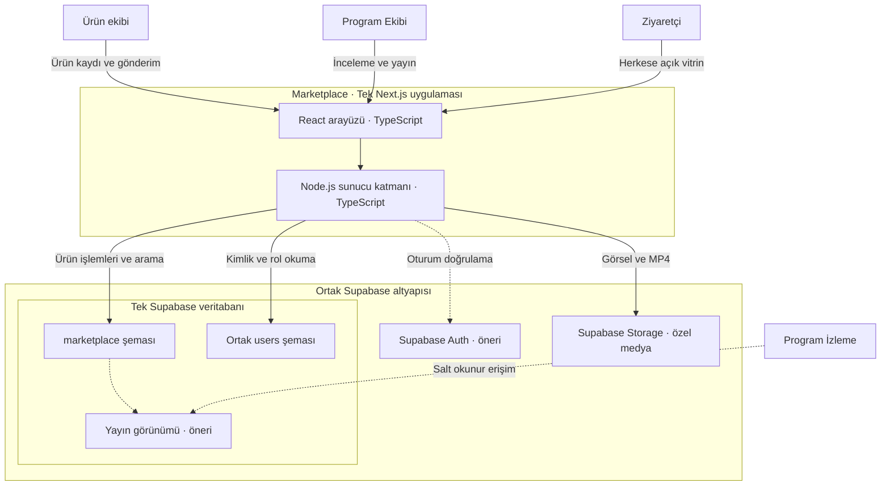

# Marketplace Mimari Şeması

**Squad 03 · S4 web demosu · Marketplace ADR v6**

Kesik oklar, ortak Supabase Auth entegrasyonu ve Program İzleme yayın sözleşmesi için teyide açık bağlantıları gösterir. Tek Supabase veritabanındaki beş şemadan Marketplace’in kullandığı `marketplace` ve `users` gösterilmiştir.

## Ürün kaydından vitrine

1. **Ürün sorumlusu** ürünü girer ve incelemeye gönderir. Next.js sunucusu yetkiyi ve gelen veriyi kontrol eder. Ürün kaydı `marketplace` şemasında, görseller ve yüklenen MP4 dosyaları özel Storage alanında tutulur.
2. **Program Ekibi** ürünü inceleme kuyruğundan açar. Önizleme, vitrindeki ürün detay bileşenini kullanır. Yayımlama işlemini yetki kontrolünden sonra sunucu uygular.
3. **Ziyaretçi** giriş yapmadan vitrini açar. Sunucu yayındaki ürünlerin yalnızca herkese açık alanlarını döndürür. Bir revizyon incelemedeyken vitrinde önceki onaylı sürüm görünür.
4. **Program İzleme** yayın bilgisini önerilen `pizle_urun_yayin_v1` görünümünden okur. Görünümün alanları ve erişim izinleri ilgili Tech Lead’lerle teyit edilecektir.

## Ekip provası

- **Client ve server nerede?** React ekranı tarayıcıda kullanıcıyla etkileşir. Node.js üzerinde çalışan Next.js sunucu katmanı yetki ve veri işlemlerini yürütür. İkisi aynı uygulama içinde geliştirilir.
- **Bir üye başka ekibin ürününü düzenleyebilir mi?** Sunucu rolü, ekip üyeliğini ve ürün sorumluluğunu ilgili ürün için kontrol eder. RLS, veritabanı düzeyinde satır erişimini sınırlar.
- **Ayrı bir REST API servisi planlandı mı?** ADR v6’da ürün işlemleri tek Next.js uygulamasının sunucu katmanında yürütülür. HTTP uç noktalarının kapsamı ve OpenAPI dokümantasyonu ekipçe belirlenecekse uygulama kararına yazılır.
- **Toplantıdaki seçenekler şemayı değiştiriyor mu?** Şema Marketplace ADR v6’yı gösterir. Flutter ve alternatif altyapı seçenekleri görüşme konusudur. Vercel, S4 demo barındırması için teyide açık adaydır.

**Dayanak** · Marketplace ADR v6, §2–4.6 ve Marketplace Tech Stack.

