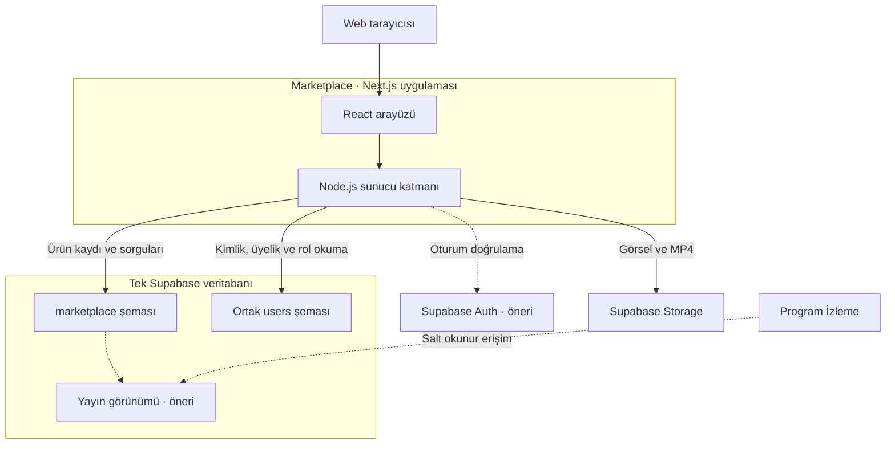

# Marketplace Tech Stack

**Squad 03 · S4 demo · İlk üç web epici**  
**Dayanak** · Marketplace ADR v6, 25 Kasım 2026. Ekip reposunda teknik kararlar `docs/kararlar.md` dosyasında tutulur.

S4 demo kapsamı ürün kaydı ve incelemeye gönderim, Program Ekibi’nin inceleme ve yayın işlemleri ve ziyaretçiye açık ürün vitrinidir.

## Teknolojiler

| Katman | Teknoloji | Marketplace’te kullanımı | Durum |
| --- | --- | --- | --- |
| Web arayüzü | Next.js, React, TypeScript | Ürün kayıt formu, Ürünlerim, inceleme kuyruğu, önizleme, vitrin ve ürün detay sayfası | Marketplace ADR v6 kararı |
| Sunucu | Next.js, Node.js, TypeScript | Yetki kontrolleri, ürün kaydı, gönderim, inceleme, yayın ve veri erişimi | Marketplace ADR v6 kararı |
| Veritabanı | Tek ortak Supabase veritabanı | Ürün kayıtları `marketplace` şemasında tutulur. Kimlik, ekip üyeliği ve roller ortak `users` şemasından okunur. | Ortak ADR-0001 kabul edildi |
| Kimlik doğrulama | Supabase Auth | Dört ürün için ortak hesap. Marketplace vitrini oturum gerektirmez. Korumalı isteklerde oturum sunucuda doğrulanır. | Ortak ADR-0007 önerisi. Oturum doğrulama standardı teyit edilecek. |
| Yetkilendirme | Sunucuda RBAC, Supabase’de RLS | Sunucu her korumalı istekte rolü ve ürün bağlamını kontrol eder. RLS satır erişimini sınırlar. | Marketplace ADR v6 kararı |
| Medya | Supabase Storage, desteklenen harici video sağlayıcıları | Görseller ve yüklenen MP4 dosyaları özel erişimli Storage alanında tutulur. Desteklenen harici video ürün detayına gömülebilir. | Marketplace ADR v6 kararı |
| Arama ve filtreleme | Supabase veritabanında PostgreSQL sorguları | Yayımlanmış ürünlerde Türkçe karakter uyumlu arama, kategori ve olgunluk filtreleri, sıralama ve sayfalama. Arama ve filtre seçimleri URL’de tutulur. | Marketplace ADR v6 kararı. Eşleştirme yöntemi ve indeksler uygulamada seçilecek. |
| Ürünler arası veri | Sürümlü, salt okunur veritabanı görünümü | Program İzleme, yayın verisine Marketplace’in sunduğu görünüm üzerinden erişir. | `pizle_urun_yayin_v1` önerisi. Sözleşme ilgili Tech Lead’lerle teyit edilecek. |
| Demo barındırma | Vercel adayı | S4 demo dağıtımı | DevOps teyidi bekleniyor |

## Mimari şema

Kesik oklar, ortak ADR’de öneri olarak kayıtlı bağlantıları gösterir.

## Neden bu yapı?

Arayüz ve sunucu kodu tek Next.js uygulamasında geliştirilir. Bir özelliği üstlenen ekip üyesi ekranı ve sunucu işlemini birlikte teslim edebilir. Bu yapı ayrı bir API uygulamasının kurulum ve entegrasyon işini azaltır. Ortak TypeScript tipleri ürün durumu ve veri alanı uyuşmazlıklarını geliştirme sırasında yakalamaya yardımcı olur. Sunucu, gelen veriyi çalışma anında da doğrular.

İnceleme önizlemesi ve ziyaretçi vitrini aynı ürün detay bileşenini kullanır. Sunucu, önizlemede kullanıcının yetkisini ve vitrin medyasında ürünün yayın durumunu kontrol eder. Yayındaki bir ürün güncellenirse ziyaretçi yeni revizyon onaylanana kadar önceki onaylı sürümü görür.

## Geliştirme ve dağıtım

- Ürün ekibi PR akışında geliştirme dalından `dev` dalına, ardından `test` ve `main` dallarına ilerler. Birleştirmeler PR üzerinden yapılır.
- Tech Lead PR’ları inceler. Birleştirme için en az bir ekip arkadaşının onayı ve başarılı pipeline gerekir. El Kitabı’nın tabanı bağımlılık kurulumu, lint, build ve mevcut testlerdir.
- S4 planında `main` demo ortamına dağıtılır. `dev` ve `test` ortamlarının eşlemesi, geliştirme ve demo ortam düzeni, Docker kapsamı ve barındırma sağlayıcısı teyit edilecek.
- Geliştirme ve demoda sentetik veri ve ortak tasarım kuralları kullanılır.

## Frontend görüşmesi

Flutter ekip görüşmesinde gündeme gelmiştir. Marketplace ADR v6’daki seçim Next.js, React ve TypeScript’tir. Flutter için karar alınacaksa web ve mobil kapsamı, ziyaretçiye açık vitrinin hangi teknolojiyle geliştirileceği ve ürün işlemlerinin hangi sunucu katmanında çalışacağı birlikte değerlendirilir. Karar değişirse önce Marketplace ADR, ardından bu sayfa güncellenir.

## Referanslar

- Marketplace ADR v6, §2 ve §3 — ortak teknik kısıtlar ve veri akışı.
- Marketplace ADR v6, §4.1–4.6 — uygulama yapısı, yetkilendirme, medya, yayın akışı, arama ve veri sözleşmesi.
- Marketplace ADR v6, §4.7 ve §6 — PR akışı, demo dağıtımı ve açık kararlar.

